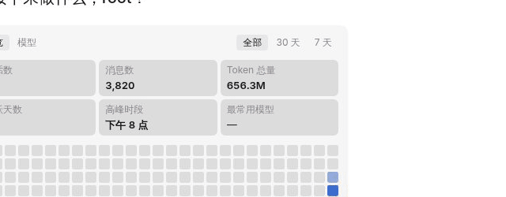

# dsh-global-prompt · Global system prompt

[**简体中文**](README.md) · [English](README.en.md)


Write your standing instructions once — every new conversation picks them up automatically.



> A DeepSeek Harness (DSH) plugin for DSH 0.2.0 or newer.

## What it does

Keeps "things the model should always know" in one place: tone, output format, hard rules, or a fixed persona. Set it once, it applies to every new chat, and it is injected in the first turn only — no token cost afterwards.

## Features

- **Global prompt**: extra requirements injected as their own system-prompt paragraph
- **Global persona**: identity and tone for the assistant, toggled independently
- **Chinese reasoning preset**: one-click "请用中文进行思考回答"
- **Effective content preview**: shows exactly what will be injected
- Toggle anything off instantly; changes apply without a restart

## Installation

**Option 1 — plugin marketplace (recommended)**

Search `dsh-global-prompt` in DSH's plugin marketplace.

**Option 2 — release tarball**

```bash
dsh plugin --profile web add https://github.com/KunKun24/dsh-global-prompt/releases/download/v1.1.0/dsh-global-prompt-1.1.0.tgz
```

**Option 3 — local source**

```bash
dsh plugin --profile web add link:/path/to/dsh-global-prompt
```

Reload the page; a "全局提示词" entry appears in the sidebar.

## Usage

1. Sidebar → "全局提示词"
2. Enable a switch and write the content (or turn on the Chinese reasoning preset)
3. Check "最终生效内容" to see the injected text
4. Start a new conversation

## Configuration

| Option | Meaning |
| --- | --- |
| Chinese reasoning preset | Built-in "please reason in Chinese" |
| Global persona | Custom identity and tone |
| Global prompt | Extra requirements such as format, language, taboos |

Limits: 4000 characters total, 2000 per field, so the context window is not squeezed.

## Compatibility & trade-offs

- Injected in the **first turn only**
- Placed after the deployment persona; deployment config is never overridden
- Scope handling avoids the Cordis guard-proxy `JSON.stringify` trap, so messages keep sending

## Data & privacy

Stored locally in your profile data directory (`global-prompt.json`). Nothing is uploaded, nothing is measured.

## Version & author

- Version **1.1.0** ([changelog](CHANGELOG.md))
- Author: 困困 (KunKun) · GitHub [@KunKun24](https://github.com/KunKun24) · Telegram [@sad1881](https://t.me/sad1881)
- License: [MIT](LICENSE)

Contains AIGC-assisted code, reviewed line by line and verified on a real instance.
